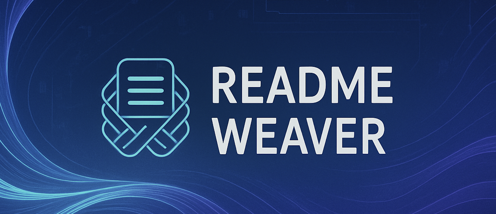

<div align="center">



## **Readme Weaver**

Seamlessly embed shared markdown into your **README** files! 🚀

[Description](#-description) • [How It Works](#-how-it-works) • [Setup - GitHub Action](#-setupgithub-action) • [Setup - Pre-Commit Hook](#-setupprecommit-hook) • [Examples](#-examples) • [Contributing](#-contributing) • [Development](#️-development)

</div>

## 📚 Description

**Readme Weaver** is a tool to keep your project documentation in sync with
shared markdown snippets. It scans your markdown files for "include"
directives, then replaces those blocks with the latest content from external
files. This is ideal for organisations that maintain common sections such as
sponsorship, contribution guidelines, or security policies across many
repositories.

By automating the inclusion of shared markdown, Readme Weaver helps you keep
your docs DRY and up‑to‑date without manual copying.

### ✨ Key Features

- **Embed shared markdown:** insert external markdown files into your README
  between clearly marked start and end tags.
- **Easy integration:** use as a GitHub Action, a pre‑commit hook, or run it
  manually with `uv` or `pip`.
- **Idempotent updates:** only the region between the include tags is replaced,
  preserving your surrounding content.

## 🔍 How It Works

Readme Weaver looks for specially formatted comment blocks in your markdown files:

```markdown
<!-- md:include start path="partials/sponsorship.md" required=true -->

…something…

<!-- md:include end -->
```

- The `path` attribute is required and specifies the location of the file to
  embed. Paths can be absolute or relative to the base directory (defaults to the
  working directory or to `README_WEAVER_BASE` if set).
- The optional `required` attribute (default `true`) controls behaviour when
  the file is missing:
  - `required=true` (or omitted): raises an error if the file is not found.
  - `required=false`: leaves the block empty if the file is missing.
- Everything between the start and end markers is replaced with the contents of
  the referenced file on each run.

> [!TIP]
> By default, relative paths are resolved from the current working directory.
> To embed files from a different location (for example, another repository),
> set the `README_WEAVER_BASE` environment variable or pass `--base-dir` on the
> command line:
>
> ```bash
> README_WEAVER_BASE=../my-org/.github uv run readme-weaver run --all-files
> ```

## 🔧 Setup – GitHub Action

Add Readme Weaver as a step in your GitHub Actions workflow to automatically
weave partials on each pull request. Here’s a sample workflow:

```yaml
name: readme weaver

on:
  pull_request:

permissions:
  contents: write

jobs:
  weave-readme:
    runs-on: ubuntu-latest
    steps:
      - uses: actions/checkout@v5
        with:
          ref: ${{ github.head_ref }}

      - name: checkout partials
        uses: actions/checkout@v5
        with:
          repository: devops-roast/.github
          # A hidden directory keeps the partials repository's own markdown
          # out of the scan. The container action can only read files inside
          # the workspace, so the partials cannot live elsewhere.
          path: .partials
          ref: main

      - name: keep partials out of commits
        run: echo "/.partials/" >> .git/info/exclude

      - name: run readme weaver
        uses: devops-roast/readme-weaver@v0.1.2 # x-release-please-version
        env:
          LOG_LEVEL: DEBUG
          # base directory for include files
          README_WEAVER_BASE: ./.partials/common-markdown

      - name: commit changes back
        uses: stefanzweifel/git-auto-commit-action@v6
        with:
          commit_message: "docs: auto-update with readme-weaver"
```

> [!NOTE]
> Readme Weaver processes every `**/*.md` file under the working directory,
> skipping hidden directories and anything inside fenced code blocks. Its output
> keeps a blank line around the woven content, so formatters such as `mdformat`
> leave it alone.

## 🔧 Setup – Pre‑Commit Hook

Readme Weaver can run as a pre‑commit hook to ensure your includes are always
up‑to‑date before committing. To install via PyPI:

```bash
pip install readme-weaver
```

Then add this to your `.pre-commit-config.yaml`:

```yaml
- repo: local
  hooks:
    - id: readme-weaver
      name: readme-weaver
      entry: readme-weaver run
      language: system
```

If you prefer to reference the repository directly:

```yaml
- repo: https://github.com/devops-roast/readme-weaver
  rev: v0.1.0
  hooks:
    - id: readme-weaver
```

> [!NOTE]
> The `--all-files` option is not needed in pre‑commit; by default only changed
> files are processed.

## 🔧 Options

| Option             | Description                                                                                                                  |
| ------------------ | ---------------------------------------------------------------------------------------------------------------------------- |
| `--all-files`      | Process all markdown files in the repository rather than only changed files (useful outside pre‑commit).                     |
| `--base-dir`/`-b`  | Override the base directory for resolving relative include paths. Defaults to `README_WEAVER_BASE` or the current directory. |
| `--log-level`/`-l` | Set the logging level (`DEBUG`, `INFO`, `WARNING`, or `ERROR`). Overrides the `LOG_LEVEL` environment variable.              |
| `--help`           | Show the command line help.                                                                                                  |

## 💡 Examples

Suppose you keep shared markdown files in a `partials` directory and want to
embed a common sponsorship section into every `README.md`.

**partials/sponsorship.md**:

```markdown
## Sponsor our work

Your support helps us build great software! ✨ Visit [our sponsoring page](https://example.com) to become a sponsor.
```

**README.md**:

```markdown
# My Project

Welcome to my project.

<!-- md:include start path="partials/sponsorship.md" required=true -->
<!-- placeholder content will be replaced -->
<!-- md:include end -->

## Usage

More docs here…
```

When you run Readme Weaver (manually, as a pre‑commit hook, or via GitHub
Actions), the section between the include tags is replaced:

```markdown
# My Project

Welcome to my project.

<!-- md:include start path="partials/sponsorship.md" required=true -->

<!-- content below is auto-generated; do not edit -->

## Sponsor our work

Your support helps us build great software! ✨ Visit [our sponsoring page](https://example.com) to become a sponsor.

<!-- md:include end -->

## Usage

More docs here…
```

If `partials/sponsorship.md` changes, rerunning the tool automatically updates
all READMEs that include it.

### Optional Includes

If you mark an include as non‑required (`required=false`) and the file is
missing, the block is simply left empty:

```markdown
<!-- md:include start path="partials/missing.md" required=false -->
<!-- md:include end -->
```

After running the tool, the section is removed without error.

## 🤝 Contributing

Contributions are welcome! To suggest an enhancement, report a bug, or submit a pull request:

- [Open a feature request](https://github.com/devops-roast/readme-weaver/issues/new?labels=enhancement&template=feature.yml) for new functionality.
- [Open a bug report](https://github.com/devops-roast/readme-weaver/issues/new?template=bug.yml) if something isn’t working as expected.
- Fork the repository, create a feature branch, make your changes and tests,
  then open a pull request. Please ensure all tests pass and follow the existing
  code style.

See the [Contributing Guide](https://github.com/devops-roast/readme-weaver?tab=contributing-ov-file) for detailed guidelines.

## 🛠️ Development

1. Fork this project
1. Install [mise](https://mise.jdx.dev/installing-mise.html).
1. Install the dependencies by using the following command:
   ```bash
   mise trust
   mise install
   uv pip install --system . -r pyproject.toml --all-extras
   ```
1. Make changes to the codebase and run the tests to make sure everything works as expected. ✅
   ```bash
   pytest -q
   ```
1. Commit your changes, push them to the repository 🚀, and open a new pull request.
